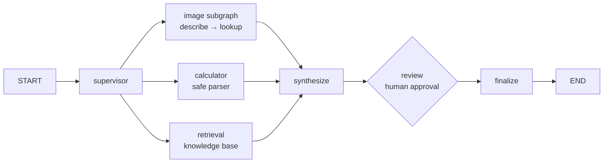

# LangGraph Multimodal Agent Orchestration

A LangGraph agent that answers questions about text and images. A supervisor plans which specialists are needed, they run in parallel, and answers based on images wait for a human to approve them before they are shared. The agent is served as a FastAPI web service.

Author: Sandesh Saidapur

## Architecture



- **Supervisor** writes a plan: which specialists the input needs.
- **Parallel branches:** the image subgraph, calculator and retrieval run in the same step. A reducer (`operator.add`) combines their notes.
- **Human approval:** `interrupt()` pauses the graph before an image-based answer is shared. A SQLite checkpointer saves the paused state, so the approval can come later, even from a new process.
- **Safe maths:** an AST-based evaluator replaces `eval`. It accepts numbers and `+ - * /` and rejects anything else.

## Results

| Check | Result |
|---|---|
| Agent test set (`phase4/evaluate.py`), 8 cases | 8 / 8 pass |
| API test suite (`app/tests/test_api.py`), 7 tests | 7 / 7 pass |

The test set covers arithmetic, division by zero, a code-injection attempt, knowledge lookups, an approved image answer, and a rejected image answer.

## Project layout

```
app/            the deployed service: graph, safe maths, API and tests
phase1–phase4/  the build-up, one folder per stage, for learning the concepts
Dockerfile      container image for the API
```

## Run it

Local (Python 3.12+):

```bash
pip install -r requirements.txt
cd app
python -m pytest -q          # run the 7 API tests
uvicorn api:app --reload     # then open http://127.0.0.1:8000/docs
```

Container:

```bash
docker build -t multimodal-agent .
docker run -p 8000:8000 multimodal-agent
```

Example requests:

```bash
# A maths question completes immediately
curl -X POST http://127.0.0.1:8000/ask -F "question=what is 12 * (3 + 4)"

# An image question pauses for review
curl -X POST http://127.0.0.1:8000/ask \
  -F "question=what does this warning mean?" \
  -F "image=@dashboard_warning.jpg"

# Approve the paused answer, using the thread_id from the previous response
curl -X POST http://127.0.0.1:8000/review/<thread_id> \
  -H "Content-Type: application/json" -d '{"decision": "approve"}'
```

## Design decisions and trade-offs

- **All specialists always start, and each one decides whether to work.** A join waits for every branch, so skipping a branch would stall the graph. The cost is that a skipped branch still starts.
- **Interrupts rerun their node on resume.** The `review` node therefore contains only the approval step, with no side effects before it.
- **Checkpoints live in SQLite** for a single-instance deployment. For several instances, swap in a shared Postgres checkpointer.
- **The API accepts uploads but keeps only the file name.** The client cannot choose a path on the server.

## Limitations

- The vision and router models are stand-ins. The vision model reads the image's file name, not its pixels, and the router uses keyword rules. The graph is written so that a real model can replace either one without changing the flow. Calling a hosted model is the next step.
- The knowledge base is a small dictionary, not a document index.
- The Docker image has not been built and run in CI yet.

## Roadmap

- Connect a real vision model and an LLM router.
- Replace the dictionary with retrieval over a service-manual index.
- Add tracing for each node's latency and cost.
